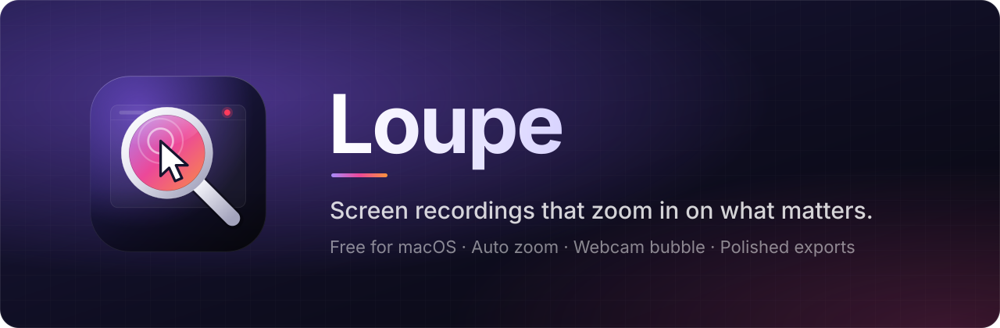
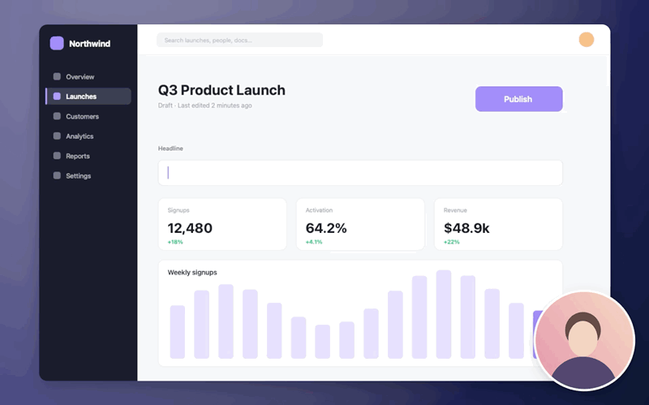
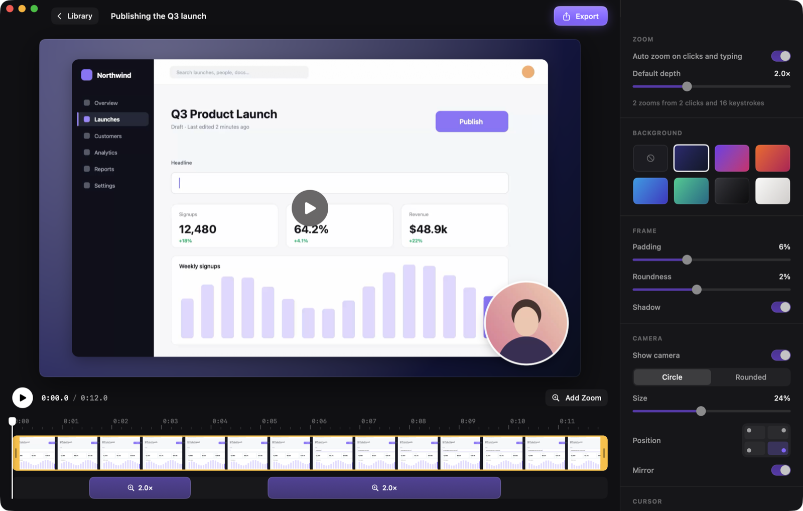

<p align="center">
  
</p>

<p align="center">
  <a href="https://github.com/Jean-PierreGassin/Loupe/releases/latest"></a>
  
  <a href="https://github.com/Jean-PierreGassin/Loupe/actions/workflows/ci.yml"></a>
  <a href="LICENSE"></a>
</p>

Loupe is a free, open-source screen recorder for macOS. Record your screen, voice and webcam, and Loupe zooms in on
every click and typing burst for you, then exports a polished MP4 ready to share.

<p align="center">
  
</p>

## Features

- **Auto zoom** on clicks and typing, following the text caret with a smooth spring camera
- **Webcam bubble** you place while recording and can restyle or move afterwards
- **Timeline editor** to trim, add, move and retune zooms
- **Styled exports** with backgrounds, padding, rounded corners and shadows, up to 4K
- **Private by design**: no account, no uploads, everything stays on your Mac. Keystrokes are timestamped, never logged

<p align="center">
  
</p>

## Install

1. Download the DMG from the [latest release](https://github.com/Jean-PierreGassin/Loupe/releases/latest) and drag **Loupe** to Applications.
2. Open Loupe. Release builds aren't notarized yet, so if macOS blocks the first launch, open
   **System Settings → Privacy & Security** and choose **Open Anyway**.
3. Click **New Recording** (or press **⌥⇧⌘R**) and allow Screen Recording, Camera and Microphone. Accessibility is
   optional and turns on typing zoom.

Loupe needs macOS 15 or later and runs natively on Apple silicon and Intel. Recordings are saved to
`~/Movies/Loupe` and exports to `~/Movies/Loupe/Exports`. Loupe checks GitHub for new versions once a day and
installs them in place, keeping your permissions. Use **Loupe → Check for Updates…** to check now.

## Build from source

```sh
git clone https://github.com/Jean-PierreGassin/Loupe.git && cd Loupe
./scripts/bundle.sh && open dist/Loupe.app
```

Building needs Xcode 26 or later. See [CONTRIBUTING.md](CONTRIBUTING.md) for tests, signing and releases.

## License

[MIT](LICENSE)
